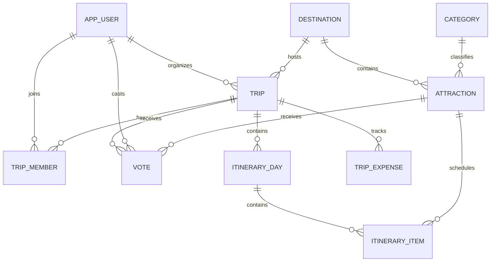

# Social Travel Planner Documentation

## Problem and scope

Groups often struggle to agree on low-cost activities and turn their choices into a shared schedule. This basic version supports one seeded trip, searchable attractions, votes, an itinerary and budget summary. It deliberately excludes bookings, live weather, invitations and production authentication.

## Architecture

```text
Browser -> Next.js pages / Route Handler -> PostgreSQL + pgvector
                                      -> Docker seed data
```

## ER diagram



## Key tables

| Table | Purpose |
|---|---|
| `app_user`, `trip_member` | organizer/member roles and trip membership |
| `trip`, `destination` | trip dates, budget and destination |
| `attraction`, `category` | searchable destination catalogue and vector embedding |
| `vote` | one vote per member, attraction and trip |
| `itinerary_day`, `itinerary_item` | day-wise schedule |
| `trip_expense`, `weather_snapshot` | simple dashboard context |

## Database justification

PostgreSQL is appropriate for related and constrained trip data. pgvector is the second data paradigm: it stores a compact attraction-description embedding and ranks similar places with vector distance. The demo uses three-value placeholder embeddings to keep the seed completely offline; a production version would create real embeddings with a documented model.

## Advanced features

1. `vote_summary_view` and `trip_dashboard_view` prevent duplication of common dashboard joins.
2. `check_itinerary_conflicts` is a stored function for schedule checks.
3. `validate_itinerary_item` is a trigger that blocks overlapping times.
4. Foreign-key/category/date/vote indexes support frequent queries.
5. `search_attractions` performs pgvector similarity search.
6. The vote API uses a database transaction.

## Test checklist

| Test | Expected result |
|---|---|
| Start Docker database | schema and seeded Goa data appear |
| Load home page | trip summary, attractions and itinerary display |
| Search `beach` | Palolem Beach is displayed |
| Vote as seeded organizer twice | first vote saves; second returns conflict |
| Insert overlapping itinerary item | trigger rejects it |
| Run `SELECT * FROM search_attractions('[0.9,0.1,0.2]',3)` | related attractions are ordered by distance |
| Log in as organizer/member/admin | role-based navigation and page access are applied |
| Register a new user | a hashed password and database-backed session are created |
| Create a trip / invitation / preference | the dashboard updates after a successful API transaction |

## Contributions

Member 1 owns data/schema/vector search and database tests. Member 2 owns web screens/routes/itinerary UI and interface tests. Both should make their own commits, including a small database and small application change each.
